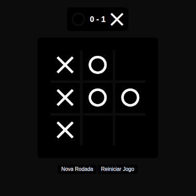

# ⏱️ Jogo da Velha

Jogo da velha feito com HTML, CSS e JavaScript puros. Contém botão para zerar o tabuleiro e iniciar uma nova partida e um para reiniciar o jogo.



🔗 **Demo:** [https://eduardo2382.github.io/tictactoe](https://eduardo2382.github.io/tictactoe)

## ✨ Funcionalidades

- Partidas para dois jogadores, alternando entre X e O
- Verificação automática de vitória e empate
- Placar de vitórias e empates
- Botão para reiniciar a partida
- Layout responsivo

## 🛠️ Tecnologias

- **HTML5** – estrutura da página
- **CSS3** – estilização e layout
- **JavaScript** – lógica do jogo

## 🚀 Como executar

Não precisa instalar nada. Basta:

```bash
# Clone o repositório
git clone https://github.com/eduardo2382/tictactoe.git

# Entre na pasta
cd tictactoe
```

Depois, abra o arquivo `index.html` no navegador (dois cliques nele já funciona).

## 📁 Estrutura do projeto

```
├── index.html
├── style.css
├── script.js
└── images/preview.png
```

## 🗺️ Próximos passos

- [x] Melhorar a responsividade para telas menores
- [ ] Refatorar a estilização utilizando **Tailwind CSS**
- [ ] Campo para inserir o nome dos jogadores
- [ ] Tabuleiros maiores (4x4, 5x5)
- [ ] Placar salvo com localStorage, que persiste ao recarregar a página
- [ ] Modo contra o computador, com IA aleatória ou invencível (algoritmo Minimax)
 

## 👨‍💻 Autor

Feito por **eduardo2382**

[](https://github.com/eduardo2382)
[](https://instagram.com/edumotaa__)
[](https://www.linkedin.com/in/eduardo-mota-3304503b2)
